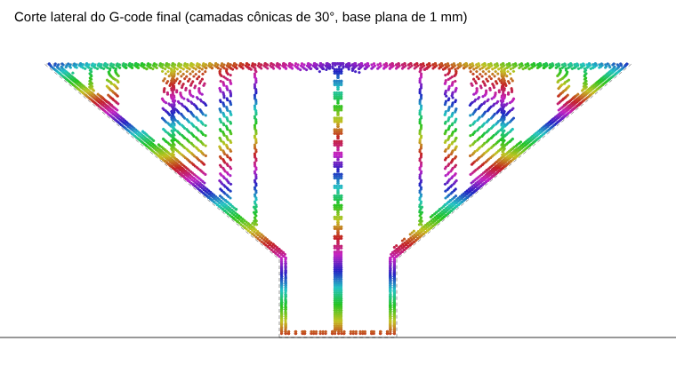

# naoplanar

**Non-planar** slicing for ordinary 3-axis 3D printers, on macOS, Linux and Windows. It works together with the slicer you already use (OrcaSlicer or PrusaSlicer): naoplanar deforms the model before slicing and undoes the deformation in the G-code afterwards, so each flat layer becomes a curved surface in the real part.

The interface is available in English and Portuguese. The command-line tool and the code are in Portuguese (*naoplanar* means "non-planar").

> Status: work in progress. Tested end to end with OrcaSlicer 2.5 and PrusaSlicer 2.7 on test models. The first real prints on an Ender-3 V3 SE hit the part-cooling duct (at 15°, and again at 8°), so the collision model is still being calibrated. **Watch your first prints closely.**

## How it works

1. **Deform:** every point of the model is raised by a surface height `H(x, y)`. For a cone, `H = r·tan(θ)`, where `r` is the distance to the cone axis.
2. **Slice:** the deformed mesh is sliced normally, with flat layers.
3. **Transform back:** in the G-code, each move is split into segments of at most 1 mm and lowered by `H(x, y)`. Each flat layer becomes a copy of the surface in the real part.

With a positive angle the layers slope down outwards, so overhangs that open outwards (funnels, mushrooms, eaves) print without support. With a negative angle the layers slope up outwards.

The `--base` option keeps the first layers flat so the part sticks to the bed, with a smooth transition to the full surface. Always use it with a positive angle: without it, the layers meet the bed at an angle and the nozzle can scrape it. In the transition the layers get thinner (down to half the configured height at the edge of the part) with a positive angle, or thicker with a negative one. Extrusion is compensated, as long as **Use relative E distances** is enabled.



The cut above is from the test model (`exemplos/funil.stl`): a stem with a funnel at 50° from vertical, which would need support with flat slicing. The image predates a fix in the transition and still shows the old slope, about 4° to 13° on the wall. With `--angulo 30 --base 1` the slope now goes from 11° at the start of the wall to 30° from about 18 mm up.

## Interface

```sh
npm run interface
```

The page opens in your browser (a local address, only on your computer). Pick the language in the top right corner. Then:

1. drop the part STL;
2. drop a G-code or 3MF you already exported from OrcaSlicer: the printer, process and filament settings are taken from it and saved for next time. Arc fitting, relative E and object labels are adjusted automatically;
3. choose the layers: a flat base and one or more anchors, each with a shape (cone, pyramid, wedge, tilted plane, dome), an angle and a height. The side cut shows the layers inside the part as you edit;
4. set up the print head (clearance, safety margin and, optionally, the STL of the fan duct);
5. click **Generate G-code**. naoplanar deforms the part, slices it with OrcaSlicer from the command line, undoes the deformation, checks for collisions and shows the toolpath in 3D. If a collision is expected, the download is held back.

Requires OrcaSlicer installed in `/Applications` (or its path in the `NAOPLANAR_ORCA` environment variable). The settings and print head profile are stored in `~/.naoplanar`.

### Anchors and shapes

Every layer is the same surface shifted vertically, so neighbouring layers never cross. With more than one anchor the surface changes with height: between two anchors the *heights* of the two surfaces are blended, not the angles, because blending angles layer by layer makes neighbouring layers intersect. The interface rejects blends that are too abrupt, where the real layers would be thinner than half or thicker than twice the configured height.

| Shape | Height `H` |
|---|---|
| Cone | `r·tan θ` |
| Pyramid | `max(|u|, |v|)·tan θ` |
| Wedge | `|u|·tan θ` (fold along a line) |
| Tilted | `u·tan θ` (tilted plane) |
| Dome | sphere up to the part radius, then a tangent cone |

`(u, v)` are the coordinates rotated by the anchor's direction. No shape is steeper than the cone with the same angle.

## Command line

Requires Node.js 22.18 or newer (TypeScript runs directly, with no build step and no dependencies).

```sh
node src/cli.ts deformar part.stl --angulo 30 --base 1
# slice part.naoplanar.stl in OrcaSlicer and export the G-code
node src/cli.ts retransformar part.gcode --saida part.final.gcode
```

In the slicer:
- disable **Arc fitting** (G2/G3 arcs are not supported);
- enable **Use relative E distances** (recommended);
- you can place the part anywhere on the bed, but do not rotate it: the cone centre is detected from the G-code.

### Automatic transform in OrcaSlicer

Set this up once and step 3 happens automatically whenever you export or send the G-code:

1. In the Terminal, find Node with `which node` (on a Mac usually `/opt/homebrew/bin/node` or `/usr/local/bin/node`).
2. In OrcaSlicer, under **Process > Others > Post-processing Scripts**, add a line with the Node path, the path to `cli.ts` and the word `retransformar`:

   ```
   /opt/homebrew/bin/node /Users/you/naoplanar/src/cli.ts retransformar
   ```

3. Keep **Label objects** enabled (Process > Others). naoplanar finds the right parameters by the object name in the G-code.
4. Save the process. The script can stay enabled all the time:
   - ordinary parts pass through unchanged;
   - `*.naoplanar.stl` parts are transformed with the parameters that `deformar` stored in `~/.naoplanar/pecas/`;
   - a file that was already transformed is never transformed again;
   - if a collision is found, Orca shows the error and does not export.

Do not rename the part inside Orca: its name must keep ending in `.naoplanar`.

### Printer profile

Printer settings are saved in `~/.naoplanar/perfil.json` and apply to every `retransformar`, including the automatic one:

```sh
node src/cli.ts perfil --folga 7 --z-max 5   # save
node src/cli.ts perfil                       # show
```

Options passed directly to `retransformar` apply to that run only.

## Smooth top

With non-planar layers, a flat top (or any top that does not follow the layer surface) comes out stepped, one layer high. With `--topo-liso` on `deformar`, the last top layer is raised to the real surface of the part and extrusion grows in the same proportion to fill the thicker layer. Travel moves over the top pass above it.

```sh
node src/cli.ts deformar part.stl --angulo 15 --base 1 --topo-liso
```

`retransformar` reads the original STL to know the surface, so do not move or delete it. It also reads the layer height that the slicer writes in the G-code. Works with the "Top surface" (OrcaSlicer), "Top solid infill" (PrusaSlicer) and "Ironing" types. `--sem-topo-liso` turns it off for one run.

On the example funnel at 15°, the last top layer varied by 0.15 mm in height and now sits entirely at 28.00 mm. Top extrusion grew by 22%.

## Collision check

With non-planar layers, material on the inner side of the layer sits higher than the nozzle tip. If it rises above the lowest part of the print head (heater block, shroud, fan duct), the head hits the part. `retransformar` simulates the whole print with a height map and, if a collision is found, **does not write the file** and reports where it would happen and how much clearance the file needs.

Clearance depends on your print head, so measure it before printing:

1. With the printer cold, move Z to 10 mm.
2. Measure from the bed to the lowest part of the print head, not counting the nozzle.
3. Subtract 10. The result is `--folga` (clearance).

Save it in the profile (`node src/cli.ts perfil --folga 7`). Without a profile the default is 5 mm. The check covers the print head up to 30 mm from the nozzle (`--raio-cabeca`) and ignores material within 1.5 mm of the tip (`--raio-bico`), where the nozzle smooths the neighbouring line. `--margem` adds a safety margin: the head is treated as that much lower.

Reference, with the example funnel and `--base 1`: at 15° it needs 5.8 mm of clearance, and at 30° it needs 9.8 mm. As a rule of thumb, the required clearance grows with `part width × tan(θ)`.

### Real print head shape

The default model treats the print head as a flat disc around the nozzle. If a low part of the head has an irregular shape (for example, a fan duct with outlets only on the sides), you can use its STL:

```sh
node src/cli.ts perfil --cabecote-stl duct.stl --bico 10.9,6.2,-27.65 --folga 8
```

- The STL must be Z up, oriented as mounted.
- `--bico` is the position of the nozzle tip in that STL's coordinates: centred between the outlets, below the lowest part of the duct by the measured clearance.
- `--folga` then applies to the rest of the print head (heater block, shroud), and at each point the smaller of the two wins.

On the author's Ender-3 V3 SE, the 5015 duct touched a 15° funnel at Z 17.67 mm. Reproducing that contact required an effective clearance of about 3.85 mm under the duct, and the prediction is very sensitive: 0.3 mm less moves the first contact down to Z 17. An 8° funnel, which passed the check with a 1.5 mm margin, also hit during printing, so treat the shape-based check as a guide, not a guarantee.

`--z-max` takes the firmware's `max_z_velocity` and warns when the firmware will slow the print down because Z cannot keep up.

Tests: `npm test`. Full example: `npm run funil`, then the commands above with `exemplos/funil.stl`.

## Known limitations

- **Collision:** the check uses a simple model of the print head (a thin cylinder for the nozzle and a plane, or the duct STL, for the rest). It is calibrated from a single real contact so far.
- **Tops are stepped** without `--topo-liso`. With it, only the last layer rises to the surface, so the layer below still has steps, which stay hidden.
- **Long travel moves rise and fall** with the surface. They do not hit what was already printed, but they are slower.
- A non-planar layer is thinner perpendicular to itself (`height × cos θ`), but the volume between two layers is the same as with flat layers, so the slicer's extrusion is already right. Only the base transition needs compensation, and it is applied (`--fator-e` exists for manual tests).
- **Skirt and brim without `--base`:** with a positive angle, the part outside the object would be below the bed, and `retransformar` rejects the G-code with an error.
- One surface axis per part. Several parts on the bed are not supported yet.
- Surfaces follow a vertical axis only. Layers that follow a curved path through the part would need a printer that tilts the nozzle.

## License

MIT.
